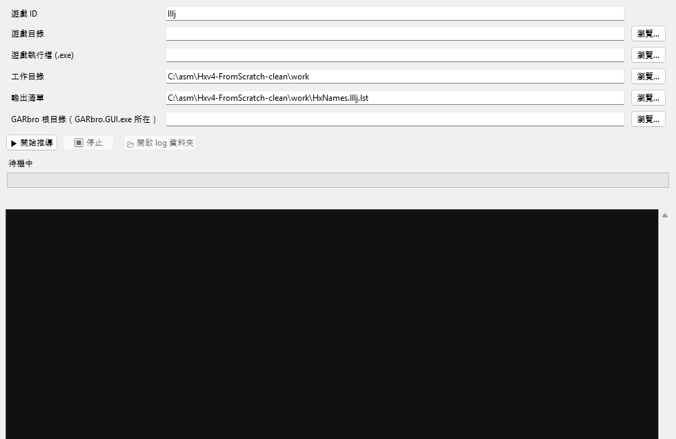

# Hxv4 檔名還原工具

Hxv4（Cxdec / Hxv4 保護）會把 KiriKiri XP3 內的檔名換成亂碼假名。

已驗證的三款遊戲（清單附在 `data/`）：

|遊戲|找到 / 總 entry|覆蓋率|
|-|-|-|
|ライムライト・レモネードジャム (lllj)|61,310 / 61,327|99.97%|
|天使☆騒々 RE-BOOT! (tenshi)|58,136 / 58,166|99.95%|
|Sanoba Witch / Sabbat of the Witch|47,997 / 48,006|99.98%|


## 需求

* Windows 10/11
* Python 3.10+
* 遊戲目錄（`\*.xp3` 與執行檔）
* `drip\_program.json` 會由程式自動產生，不需要先準備

第一次執行會自動準備第三方元件（PyCryptodome、cxdec 參考實作、KrkrDump、
inject\_launch）：Python 套件用 pip 安裝，其餘從**原始上游**下載；詳見
`THIRD-PARTY.md`。

## 快速開始（GUI）

```powershell
pip install -r requirements.txt      # 也可以第一次執行時自動安裝
python tools/run\_gui.py
```

在視窗填入：遊戲 ID、遊戲目錄、遊戲執行檔 (.exe)、輸出清單、GARbro 根目錄
（`GARbro.GUI.exe` 所在資料夾）→ 按「開始推導」。程式會先自動產生
`drip\_program.json`，再開始推導。視窗會即時顯示：

* 目前階段（N/13）、進度條、耗時與速度
* 完整 log（同時寫入 `work/logs/<game>\_<timestamp>.log`）
* 完成後自動把 `ArcHxv4.dll` 放進 GARbro 根目錄，`HxNames.lst` 與
`drip\_program.json` 放進 GARbro 的 `GameData\\`



## 快速開始（指令列）

```powershell
python tools/run\_pipeline.py --game <id> ^
  --game-dir "C:\\Game" --exe "C:\\Game\\game.exe" ^
  --out "work\\HxNames.<id>.lst" ^
  --garbro-dir "C:\\GARbro"
```

`--exe` 是遊戲執行檔；沒有 `--drip` 時會先自動產生 `drip\_program.json`。

`--garbro-dir` 給 GARbro 根目錄（`GARbro.GUI.exe` 所在資料夾）即可；`ArcHxv4.dll` 會放到根目錄
（GARbro 只載入根目錄的 `Arc\*.dll`），`HxNames.lst` 與 `drip\_program.json` 則放到 `GameData\\`。

第一次會解密 corpus（幾分鐘），之後重跑用快取（約 30 秒）。

## 使用 `data/` 裡做好的清單

`data/HxNames.lllj.lst`、`data/HxNames.tenshi.lst`、`data/HxNames.sanoba.lst`
可直接給 GARbro 用；所有 64-hex 檔名都用 hash 驗證過。詳細來源見
`data/README.md`：

1. 選一款遊戲的清單，複製並**改名成 `HxNames.lst`**。
2. 把 `HxNames.lst` 放到 **GARbro 的 `GameData\\`**（和社群 Hxv4 清單同一位置）。
3. 同一個 `GameData\\` 資料夾要有該遊戲的 `drip\_program.json`；換遊戲時
`HxNames.lst` 和 `drip\_program.json` 要一起換。
4. 放好後重開 GARbro，開 XP3 就會顯示對應的真檔名；不需要修改遊戲檔案。

`ArcHxv4.dll` 仍然必須放在 **GARbro 根目錄**（和 `GARbro.GUI.exe` 同層），
不能只用 `GameData\\` 的清單取代外掛：

* 這份 `HxNames.lst` 只是「雜湊 → 檔名」對照表；讀 XP3 的 Hxv4 index、
解密 Hxv4 表與 entry 內容仍由 `ArcHxv4.dll` 負責。
* 在沒有本專案外掛時，GARbro-Mod 內建的 XP3 reader 對這幾款遊戲不一定能開
（實測 lllj 可以，tenshi、Sanoba Witch 會顯示 `unknown format`），
所以 `GameData\\HxNames.lst` 不能單獨取代 `ArcHxv4.dll`。

## 動態 dump 的兩種模式

```powershell
# 自動進標題後 dump，完成自動關閉遊戲
python tools/dynamic\_dump.py --game <id> --game-dir "C:\\Game" --auto

# 只開啟遊戲，讓使用者自己操作；關閉遊戲後收集退出前的所有檔名
python tools/dynamic\_dump.py --game <id> --game-dir "C:\\Game" --manual
```

* `--auto`：自動點過 ATTENTION／logo 到標題主頁，dump 後關掉遊戲（預設模式）。
* `--manual`：工具不點擊、不關遊戲；你可以操作到主頁、選單、遊戲內，關閉遊戲後
工具會把所有打開過的檔名寫成 `work/HxNames.dynamic.<id>.lst`。
* 兩者都需要 `tools/krkr` 裡的 KrkrDump（bootstrap 會從原始 release 自動下載）。

## 詳細步驟

每款新遊戲的完整流程（產生 drip、可選 digest 校準、動態 dump、合併、
GARbro 安裝、疑難排解）見 [**GUIDE.md**](GUIDE.md)。

## 內容

```
lib/                推導核心（hxlib）與第三方 python/工具
tools/              CLI 與 GUI 工具；tools/krkr 需自行取得 KrkrDump
plugin/             GARbro ArcHxv4 外掛原始碼
out/ArcHxv4.dll     外掛建置產物（GARbro 用）
lib/pbd2json.exe    選用的 PBD 解析器（純 Python 解析器為主）
data/               三款遊戲的完整聯集清單
tests/              單元測試（不需要遊戲資料）
GUIDE.md            使用指南（含每款遊戲的產生步驟）
THIRD-PARTY.md      第三方元件與授權
```

## 測試

```powershell
python tests/test\_core.py
```

## 授權

本專案程式碼為 MIT（見 `LICENSE`）。第三方元件授權見 `THIRD-PARTY.md`。
遊戲資料與檔名版權屬原權利人所有。

