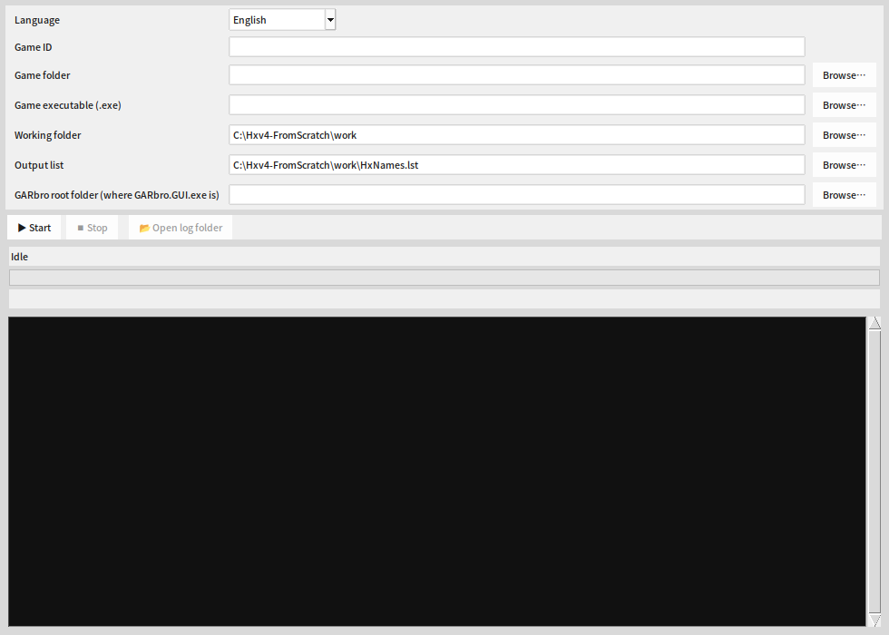

# Hxv4 Filename Recovery Tool

Hxv4 (Cxdec / Hxv4 protection) replaces the filenames inside KiriKiri XP3 archives with garbled fake names.

Four verified games (lists included in `data/`):

|Game|Found / Total entries|Coverage|
|-|-|-|
|ライムライト・レモネードジャム (lllj)|61,310 / 61,327|99.97%|
|天使☆騒々 RE-BOOT! (tenshi)|58,136 / 58,166|99.95%|
|Sanoba Witch / Sabbat of the Witch|47,997 / 48,006|99.98%|
|喫茶ステラと死神の蝶 (CafeStella)|48,159 / 48,271|99.77%|


## Requirements

* Windows 10/11
* Python 3.10+
* Game folder (`*.xp3` and the game executable)
* `drip_program.json` is generated automatically by the program; no need to prepare it in advance

On the first run, third-party components (PyCryptodome, the cxdec reference implementation, KrkrDump, and
inject_launch) are prepared automatically: Python packages are installed with pip, and the rest are downloaded
from the **original upstream**; see `THIRD-PARTY.md`.

## Quick Start (GUI)

```powershell
pip install -r requirements.txt      # can also be installed automatically on first run
python tools/run_gui.py
```

In the window, fill in: game ID, game folder, game executable (.exe), output list, and GARbro root folder
(the folder containing `GARbro.GUI.exe`) → press "Start". The program first generates
`drip_program.json` automatically, then starts the recovery. The window displays in real time:

* Current stage (N/13), progress bar, elapsed time, and speed
* Full log (also written to `work/logs/<game>_<timestamp>.log`)
* When finished, automatically places `ArcHxv4.dll` in the GARbro root folder, and puts `HxNames.lst` and
`drip_program.json` into GARbro's `GameData\`



## Quick Start (Command Line)

```powershell
python tools/run_pipeline.py --game <id> ^
  --game-dir "C:\Game" --exe "C:\Game\game.exe" ^
  --out "work\HxNames.<id>.lst" ^
  --garbro-dir "C:\GARbro"
```

`--exe` is the game executable; when `--drip` is not provided, `drip_program.json` is generated automatically first.

For `--garbro-dir`, just supply the GARbro root folder (the folder containing `GARbro.GUI.exe`); `ArcHxv4.dll` is placed in the root folder
(GARbro only loads `Arc*.dll` from its root folder), while `HxNames.lst` and `drip_program.json` are placed in `GameData\`.

The first run decrypts the corpus (a few minutes); later reruns use the cache (about 30 seconds).

## Using the Prebuilt Lists in `data/`

`data/HxNames.lllj.lst`, `data/HxNames.tenshi.lst`, and `data/HxNames.sanoba.lst`
can be used directly with GARbro; all 64-hex filenames have been verified by hash. See
`data/README.md` for detailed provenance:

1. Pick one game's list, copy it, and **rename it to `HxNames.lst`**.
2. Place `HxNames.lst` in **GARbro's `GameData\`** (the same location as the community Hxv4 lists).
3. The same `GameData\` folder must contain that game's `drip_program.json`; when switching games,
`HxNames.lst` and `drip_program.json` must be replaced together.
4. After placing them, restart GARbro; opening an XP3 will show the corresponding real filenames; there is no need to modify the game files.

`ArcHxv4.dll` must be placed in the **GARbro root folder** (the same level as `GARbro.GUI.exe`).

* `HxNames.lst`: filename mapping table.
* `ArcHxv4.dll`: reads the Hxv4 index of XP3 archives and decrypts the Hxv4 table and entry contents.

## The Two Dynamic Dump Modes

```powershell
# Automatically advance to the title screen, then dump; automatically closes the game when done
python tools/dynamic_dump.py --game <id> --game-dir "C:\Game" --auto

# Only launch the game and let the user operate it; after the game closes, collect all filenames opened before exit
python tools/dynamic_dump.py --game <id> --game-dir "C:\Game" --manual
```

* `--auto`: automatically clicks through ATTENTION/logo to the title screen, then dumps and closes the game (default mode).
* `--manual`: the tool does not click or close the game; you can operate through the title screen, menus, and in-game content; after you close the game,
the tool writes all filenames that were opened to `work/HxNames.dynamic.<id>.lst`.
* Both require KrkrDump in `tools/krkr` (the bootstrap downloads it automatically from the original release).

## Detailed Steps

See [**GUIDE.md**](GUIDE.md) for the complete workflow for each new game (generating drip, optional digest calibration, dynamic dump, merging,
GARbro installation, and troubleshooting).

## Contents

```
lib/                recovery core (hxlib) and third-party Python/tools
tools/              CLI and GUI tools; tools/krkr requires obtaining KrkrDump yourself
plugin/             GARbro ArcHxv4 plugin source code
out/ArcHxv4.dll     plugin build artifact (for GARbro)
lib/pbd2json.exe    optional PBD parser (the pure-Python parser is the primary one)
data/               complete union lists for three games
tests/              unit tests (no game data required)
GUIDE.md            usage guide (including the generation steps for each game)
THIRD-PARTY.md      third-party components and licenses
```

## Tests

```powershell
python tests/test_core.py
```

## License

This project's code is MIT licensed (see `LICENSE`). For third-party component licenses, see `THIRD-PARTY.md`.
The copyright of game data and filenames belongs to their respective rights holders.

